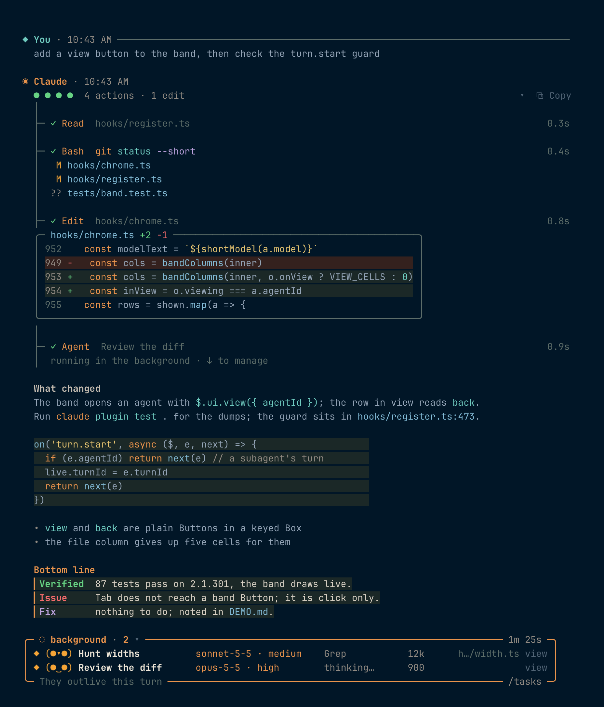
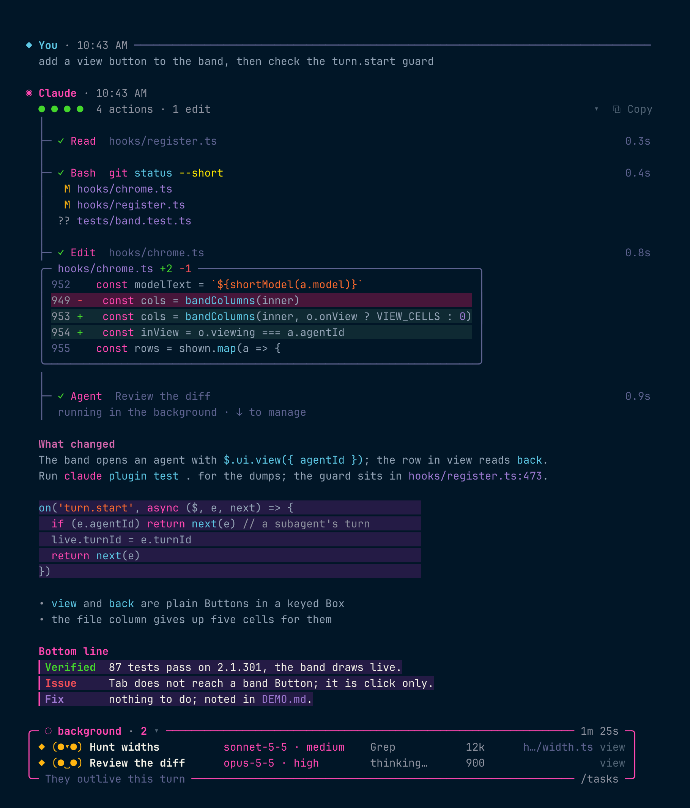
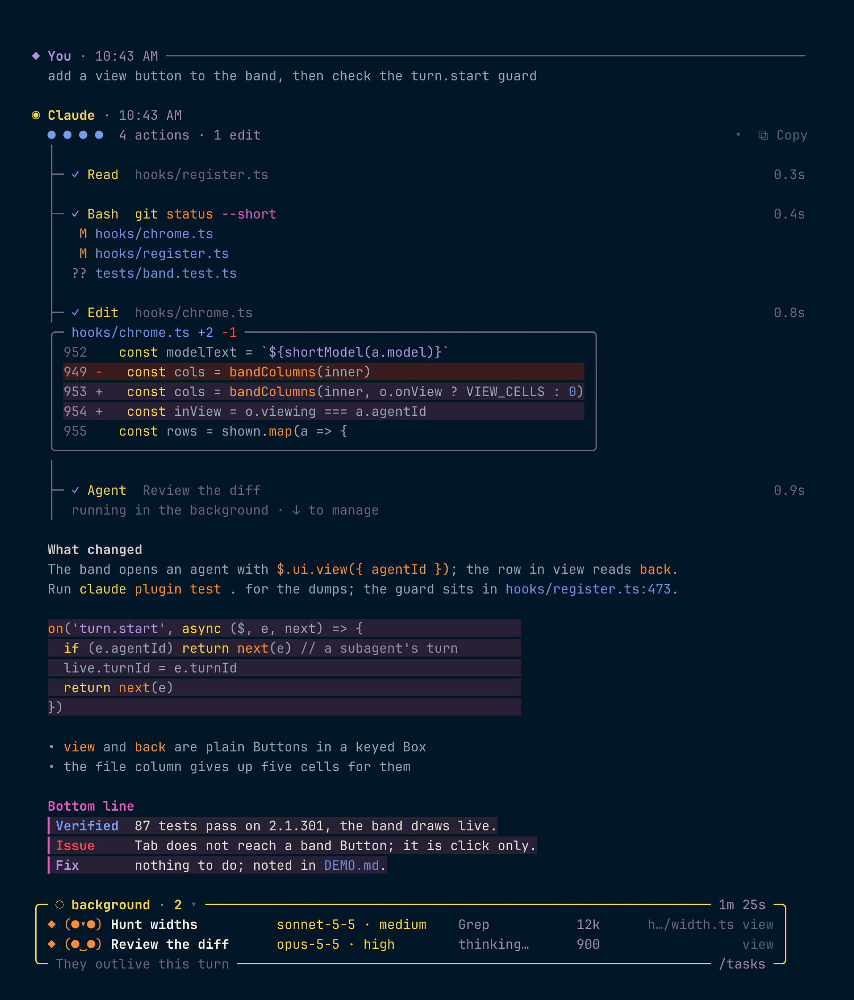
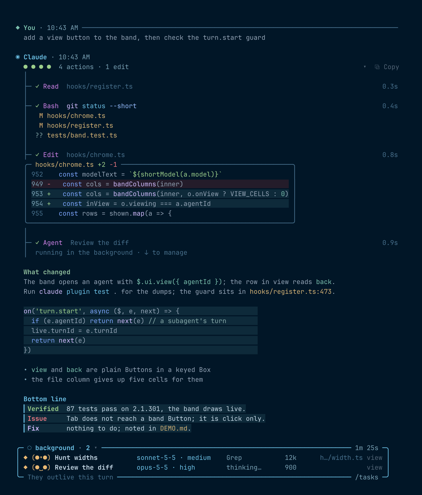
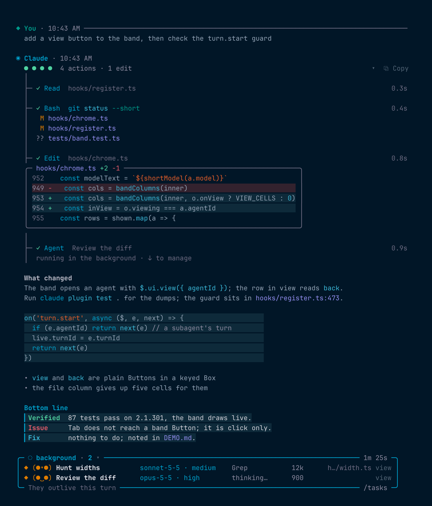
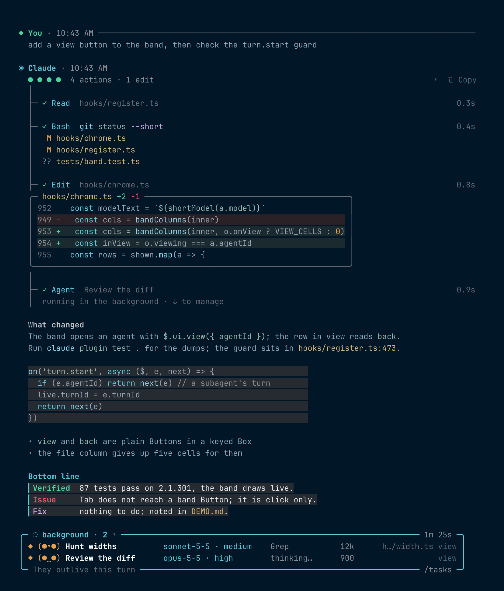
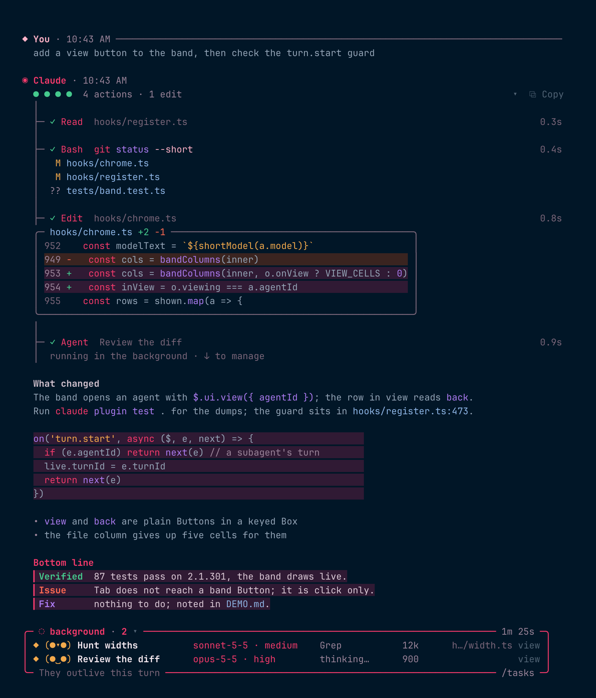
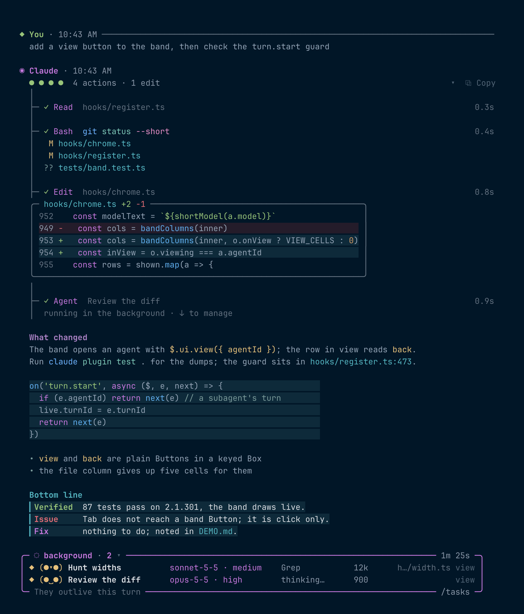
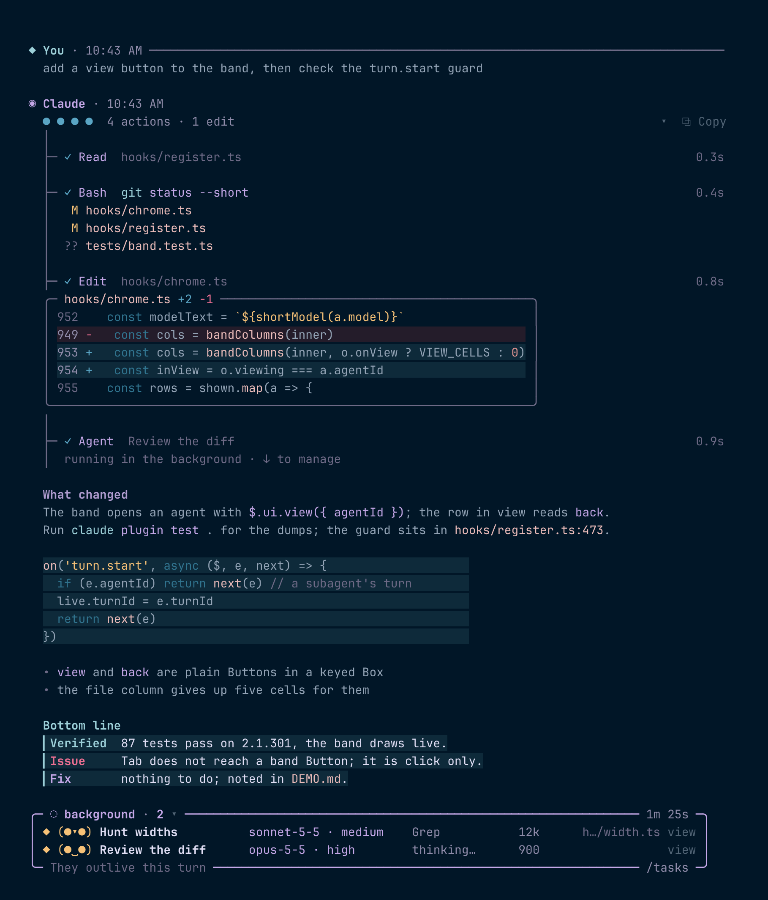

# glass

A desktop-app look for Claude Code's terminal transcript, as a mod.

https://github.com/user-attachments/assets/365252bf-4b60-49c3-902b-b8e127592d28

## Palettes

The same turn under each palette: pick one with `/config` under Glass.

<table>
<tr>
<td><strong>tarnish</strong> glass's own. Metals aging: copper for what is happening now, the verdigris it weathers to for what has settled, brass strings, steel paths, tarnished silver for flags. Placed in OKLCH.<br><br></td>
</tr>
<tr>
<td><strong>overprint</strong> glass's own. Risograph inks on black paper: fluorescent pink, aqua, yellow, orange, violet; the card tints are an ink overprinted on black. Loud by design.<br><br></td>
</tr>
<tr>
<td><strong>ironbow</strong> glass's own. The thermal camera gradient, heat for activity: yellow verb, orange builtins, magenta flags, violet strings, cold-blue paths; done is cold, so the dots are blue.<br><br></td>
</tr>
<tr>
<td><strong>tidepool</strong> (default) my nvim theme, mapped by role.<br><br></td>
</tr>
<tr>
<td><strong>water</strong> Empryo's own proxysoul-water tokens.<br><br></td>
</tr>
<tr>
<td><strong>undertow</strong> sampled from Empryo's desktop video.<br><br></td>
</tr>
<tr>
<td><strong>crimson</strong> Empryo's crimson world, "the heart", from empryo.com's CSS.<br><br></td>
</tr>
<tr>
<td><strong>codex</strong> One Dark.<br><br></td>
</tr>
<tr>
<td><strong>rose</strong> Rose Pine.<br><br></td>
</tr>
</table>

## What it draws

- **Commands in color.** Inside backticks and in plain prose: command,
  subcommand, flag, string, path, operator, number, variable, each in its
  own color. In prose a command paints only with evidence (`git push
  --follow-tags` paints, `make sure the build passes` does not).
- **Paths and links anywhere.** `src/main.rs:42:7` with its line number in
  the number color, `README.md`, `.gitignore`, `~/.config/app.toml`. URLs
  underlined; `https` links are real OSC 8 links.
- **A Bottom line card.** A reply opening with `**Bottom line**` (or
  `**Bottom line:**`) and
  `Verified:` / `Issue:` / `Fix:` rows becomes a tinted card with a thin
  bar and colored labels. Forms while streaming, never flickers.
- **Gutter marks.** A `▎` beside any paragraph that asks something of you:
  a question, an instruction, a risk, or a thing Claude did not do. Off for
  turns whose prompt asked for writing.
- **Private notes.** A paragraph opening with `Private` or `Privately`
  draws italic and quiet.
- **Code cards.** Fences on a tinted card sized to the code, a quiet
  language header, a line count and gutter past eight lines. glass's own
  highlighter does the coloring, in the palette's code keys; a shell fence
  takes the same colors as a command in prose.
- **Diff cards.** An Edit, Write or file-changing Bash result as a rounded
  card with the file in its top border, `╭─ SPEC.md +1 -1 ───╮`: one
  number column, `+` and `-` rows on a quiet tint, one context line each
  side, the code painted the same way, the frame on the tree trunk.
- **Headings, lists, quotes, tables.** Bold colored headings with no rules,
  `•` `◦` `☐` `☑` markers, a quote bar, borderless tables with aligned
  columns and right-aligned numbers. A table a little too wide squeezes
  its widest column instead of falling back to boxes.
- **Turn headers.** `◆ You · 1:11 PM ────` as one titled rule over your
  prompt, then `◉ Claude · 1:14 PM` once the turn starts, with a dots line
  under it: one dot per tool call, grouped by tool, green, a red `✗` for a
  failure, hollow while running, then `Bash ×3 · Read ×2`. Once done the
  line reads `5 actions · 2 edits · 1 failed`. `/fold` tucks finished
  trees away and `/unfold` opens them.
- **A tool tree.** While a turn runs, every call is one row: `├─ ✓ Bash
  git status · 3 lines` with its wall time at the right, `○` while it
  runs, `✗` in red when it fails. A Bash command keeps its colors once
  done; other arguments step down to a quiet color, and paths draw
  relative to the project. Rows light under the
  pointer. The engine's folded runs name what they read: `├─ ▸ Read ×2
  SPEC.md · render.ts`. Bash output is painted, three lines then a count.
  A finished agent is one row.
- **Background band.** While subagents run, a rounded frame above the
  prompt lists them with a face, model and effort, current tool, tokens
  and the file they last touched, five at a time. The chevron folds it to
  one strip of faces. A `view` at the end of each row opens that agent's
  transcript in the main view (Claude Code 2.1.300 or newer); the row in
  view reads `back`.
- **Event rows.** A background task's notification draws as one tree row
  with its duration; a message from another agent draws as one muted row.
- **Summary rows.** A compaction summary ends on a quiet `· summary` mark,
  as the engine's own does.
- **Server tool rows.** A tool the API ran inside the request (the advisor)
  has no tool call of its own; glass draws it after the reply as a quiet
  tree row with its duration.
- **Themes.** The diff card and the mode word under the prompt take the
  active theme's own slots, so they match the engine's panels under any
  theme. `/glass-theme` writes a theme built from the current palette to
  `~/.claude/themes/glass-<palette>.json`; pick it in `/theme` (the
  engine lets a plugin select only its built-in themes). Then the prompt
  box, mode words, permission prompts and diff panels take the palette
  too. Switching the palette while a glass theme is active rewrites the
  file. Your own theme files are never touched.
- **Notifications.** A native notification when a background agent
  finishes after its turn ended, or a turn ends with failed calls. The
  engine already notifies when a turn finishes, so glass does not. Off
  with the `notify` option under Glass in `/config`.
- **Fold and Copy.** A chevron at the right of the dots line folds that
  turn's tree; `⧉ Copy` takes the finished answer to the clipboard.
  `/fold` and `/unfold` do the same from the keyboard.

Every width is measured the way the engine measures cells, so emoji and
CJK in tables stay aligned.

## Install

```
claude plugin marketplace add rashedInt32/glass
claude plugin install glass@glass
```

Claude Code 2.1.295 or newer. On an older engine glass still loads: the
notification falls back to a toast, summary and server tool rows need
props that older engines do not send, and the rest is unchanged.

Restart Claude Code. Pick a palette with `/config` under Glass: `tidepool`
(default), `tarnish`, `overprint` and `ironbow` (glass's own), `water` (Empryo's own proxysoul-water tokens), `undertow` (sampled from
Empryo's desktop video), `crimson` (Empryo's crimson world, "the heart", from
empryo.com's own CSS), `codex` or `rose`.
The palettes assume a dark terminal.

To try it from a clone without installing:

```
claude --plugin-dir /path/to/glass
```

## Design

`SPEC.md` is the contract: every element, its exact tree and colors, and
the directions that were tried and rejected, with reasons. Settled through
a design panel and an investigation against how Claude Desktop, the Codex
app and T3 Code render chat.

The `tidepool` palette maps a neovim theme of the same name by role:
strings olive, numbers and inline code pine, commands iris, builtins foam,
paths gold, links mint.

## Development

```
claude plugin validate .
npx -p typescript tsc -p .   # after the engine has laid .claude-plugin/types
claude plugin test .         # tests/*.test.ts, run in the engine's own sandbox
LC_ALL=C grep -rn '[^ -~]' hooks/   # must print nothing
```

`scripts/check.sh` runs all four and checks that both manifests carry
the same version. `scripts/demo-dump.sh before|after` writes the text
dumps `DEMO.md` compares, from `tests/demo.test.ts`. `bun scripts/show.ts`
paints the fixtures before and after in the terminal, and `bun
scripts/readme-shots.ts` shoots the palette screenshots above with
headless Chrome; both draw through `scripts/paint.ts`. CI runs it on every push and pull request, without tsc:
the types only exist once the engine has loaded the plugin.

Every non-ASCII glyph is built from a code point in `hooks/glyphs.ts`.
Literals outside ASCII are forbidden in `hooks/`: the tool path that
writes files has dropped private-use glyphs before.

## License

MIT
